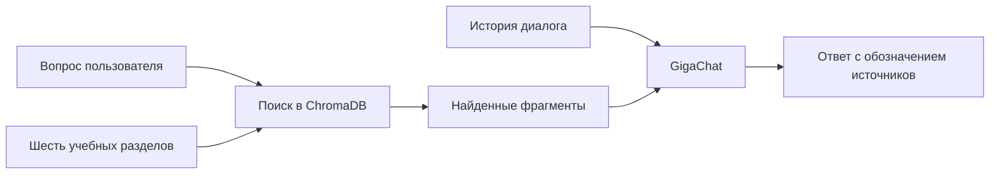

# Как работает проект

## Пример для самостоятельной проверки
Вопрос: «Сколько стоит диагностика при отказе от ремонта?»

В documents.json указано: 700 рублей; при согласии на ремонт диагностика бесплатна. Это ожидаемые факты из базы, а не сохранённая цитата ответа модели.

Контрольный вопрос: «Есть ли выезд мастера на дом?» В базе нет подтверждения услуги: ответ должен обозначить недостаток сведений.

Фактические результаты запуска тестов: [VALIDATION.md](VALIDATION.md).
