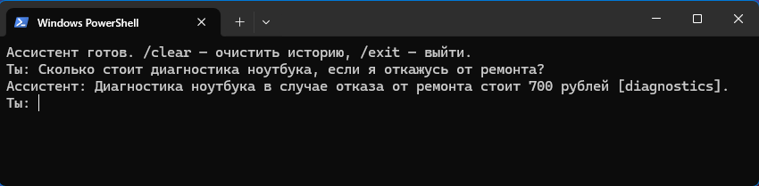

# RAG-ассистент с памятью диалога
Учебный консольный помощник: ChromaDB, локальные эмбеддинги FastEmbed и ответы GigaChat. Telegram-интерфейса нет.

## Комплект
- main.py — диалог, очистка истории и эксперимент сравнения top_k.
- ingest_documents.py и documents.json — загрузка шести разделов вымышленной базы.
- embeddings/ — исходный код векторизации, не веса модели.
- dialog_controller/ — память и управление сессиями.
- giga_client.py и config.py — доступ к провайдеру и настройки.
- test_grounding.py — два живых регрессионных теста.
- requirements.txt, .env.example, .gitignore — зависимости и настройка.

## Запуск
После подготовки выполните `python ingest_documents.py`, затем `python main.py`.
Команды: `/clear` очищает историю, `/exit` завершает диалог.
`python main.py --experiment` создаёт локальный experiment.json; `python -m unittest -v test_grounding` запускает проверки с API.
Top K по умолчанию 5. Поиск может пропустить нужный раздел. Проверка названий цитат не гарантирует достоверность ответа.
## Подготовка
Python 3.11. Установите зависимости: `python -m pip install -r requirements.txt`.
Скопируйте `.env.example` в `.env` и заполните собственный ключ GigaChat. Можно указать внешний файл переменной RAG_PROVIDER_ENV. Ключи в комплект не входят. TLS-проверка включена; GIGACHAT_CA_BUNDLE позволяет указать свой доверенный набор сертификатов.

Для поиска нужен заранее загруженный кэш модели sentence-transformers/paraphrase-multilingual-MiniLM-L12-v2 для FastEmbed. Укажите каталог через FASTEMBED_CACHE_PATH; по умолчанию используется model-cache в корне проекта. Автоматическая загрузка отключена (local_files_only=True). Модель и векторный индекс не включены.

## Данные и ограничения
Данные сервисного центра вымышлены. Найденные фрагменты и вопросы передаются GigaChat для генерации; в консольном ассистенте передаётся также история диалога. Не используйте личные данные без предварительного обезличивания. Это учебный проект, не промышленный сервис. Модель может ошибаться.

Проверки с моделью требуют локального кэша и доступа к API. Полный запуск очищенной копии на новом компьютере не выполнялся. Старые журналы экспериментов не включены; наличие тестов не означает, что они пройдены в этой копии.

## Проверено 13 ноября 2026
В очищенной копии загружены 6 разделов; оба теста test_grounding с реальным GigaChat прошли. Использовались существующая среда Python и внешний кэш модели. Установка с нуля не проверялась.

## Скриншот

Ответ консольного ассистента: 700 рублей, источник diagnostics.

[Схема и примеры](EXAMPLES.md).
